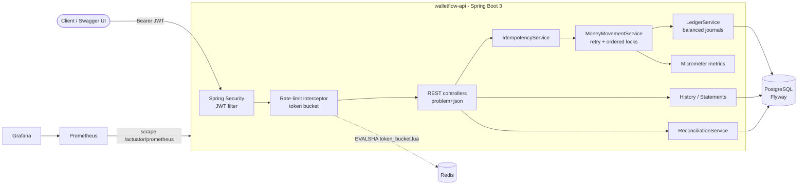
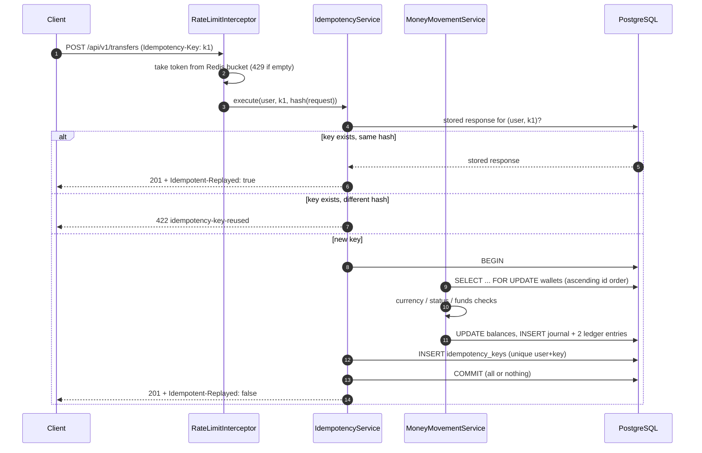
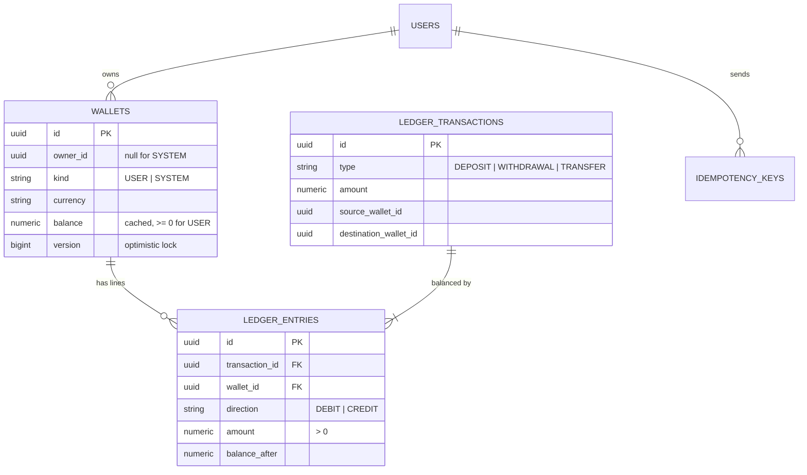

# WalletFlow API

[](https://github.com/Mohangab/walletflow-api/actions/workflows/ci.yml)


A digital wallet and payments backend built with **Spring Boot 3**. Users hold wallets in several currencies and can deposit, withdraw and send money to each other. Every money movement is written to a **double-entry ledger**. Money-moving requests are **idempotent**, **safe under concurrency** and **rate limited**, and the service exports **Prometheus metrics** with a ready-made Grafana dashboard.

The goal of the project is to get the hard parts of a payments API right, not to have many endpoints: the balance can never go negative, money is never created or lost, and a client retry never charges twice.

---

## Features

| Area | What it does |
|---|---|
| **Auth** | Register and log in with JWT (HS256) **access tokens** plus opaque, single-use **refresh tokens** that rotate on each use. Reusing a refresh token is treated as theft and revokes every session of that user. Passwords are hashed with BCrypt. Roles are `USER` and `ADMIN`. |
| **Wallets** | One wallet per user per currency (INR, USD, EUR, GBP). An admin can freeze or unfreeze a wallet. |
| **Payments** | Deposits, withdrawals and P2P transfers. The recipient is given by wallet id or by email. |
| **Double-entry ledger** | Each movement is one balanced journal (debits = credits) with immutable entries. Every entry stores `balance_after`. |
| **Reconciliation** | `GET /api/v1/admin/reconciliation` checks that each stored balance equals its ledger-derived balance, that every journal is balanced, and that the per-currency trial balance holds. The same check also runs on a schedule and is exported as gauges. |
| **Idempotency** | Every money-moving `POST` requires an `Idempotency-Key`. A replay returns the stored response with `Idempotent-Replayed: true`. The same key with a different payload returns **422**. |
| **Concurrency** | Wallet rows are locked with `SELECT … FOR UPDATE` in a **consistent order**, so there are no deadlocks. `@Version` provides optimistic locking, and transient conflicts are retried. Money is `BigDecimal` with scale 2, and a DB `CHECK` keeps balances from going negative. |
| **Rate limiting** | A per-user **token bucket in Redis** (an atomic Lua script) covers transfers. When the limit is hit the API returns **429** with `Retry-After` and `X-RateLimit-*` headers. If Redis is down, the limiter fails open. |
| **History** | Paginated wallet history with filters (type, direction, time range) and whitelisted sorting. Statements show opening and closing balances. |
| **Errors** | Every error is RFC 9457 `application/problem+json` with a stable `code`. Validation errors are reported per field. |
| **Observability** | Actuator, Micrometer and Prometheus with custom business metrics. Docker Compose also starts Prometheus (with alert rules) and Grafana (with a provisioned dashboard). |
| **API docs** | springdoc OpenAPI and Swagger UI with JWT "Authorize" support. |

## Architecture



### Transfer request lifecycle



### Double-entry ledger



Convention: a **CREDIT increases** a wallet's balance and a **DEBIT decreases** it, so `balance = Σ credits − Σ debits`. Each currency has a **SYSTEM settlement wallet** that stands for the outside world (bank rails, cards):

| Operation | Debit | Credit |
|---|---|---|
| Deposit ₹1000 | SYSTEM-INR 1000 | Alice-INR 1000 |
| Transfer ₹250 | Alice-INR 250 | Bob-INR 250 |
| Withdrawal ₹100 | Bob-INR 100 | SYSTEM-INR 100 |

Because every journal is balanced, the balances of all wallets in a currency (system included) always **sum to zero**. The system wallet's negative balance equals the money held on behalf of users.

## Design decisions

**Why double-entry?** A single `balance` column can drift silently: one bug or one manual `UPDATE` and the money is gone with no trace. With double-entry, every change is an append-only pair of entries, so (1) the balance can always be rebuilt from history, (2) money cannot appear or vanish because each journal must balance, and (3) a reconciliation job can **prove** that the cached balances are correct. The cached `wallets.balance` keeps reads O(1). The ledger is the source of truth.

**Why idempotency keys?** Mobile networks time out after a request has already succeeded on the server. Without idempotency, the client's retry sends the money a second time. The key and the stored response are written **in the same DB transaction as the ledger posting**, so there is no window where the money moved but the key is missing, or the reverse. When two identical requests race, the unique `(user_id, key)` constraint picks the winner. The loser's whole transaction rolls back, including its ledger writes, and it replays the winner's response. Failed requests are not stored, so a client can fix the cause (for example, top up the wallet) and retry with the same key.

**Why pessimistic locking with lock ordering?** A transfer must read and update two balances atomically. Under contention, optimistic locking alone would mean many retries. Row locks (`SELECT … FOR UPDATE`) serialise the writers instead. Deadlocks (A→B racing B→A) are avoided by always taking the locks in **ascending wallet-id order**. `@Version` remains as a safety net and is the only mechanism for admin freeze/unfreeze. Any `ConcurrencyFailureException` (lock timeout, deadlock victim, version conflict) is retried with backoff in a fresh transaction. Ownership checks before locking use a projection (`WalletRef`), so a stale entity is never cached ahead of the lock.

**Money handling.** All amounts are `BigDecimal` / `NUMERIC(19,2)`, never floating point. Amounts with more than 2 decimals are **rejected rather than rounded**. Non-negative balances are enforced three times: in the domain (`Wallet.debit`), by the lock, and by a DB `CHECK` constraint.

**Rate limiting.** The token bucket state lives in a Redis hash and is updated by a Lua script that uses the Redis server clock, so the limit is shared by all instances. If Redis is unreachable, the limiter **fails open**: the outage is counted in `walletflow_ratelimit_errors_total` and readiness does not depend on Redis. Correctness never relies on the limiter, because idempotency and balance checks still apply.

## Tech stack

Java 17 · Spring Boot 3.5 (Web, Security, Data JPA, Validation, Actuator, Data Redis) · PostgreSQL 17 · Flyway · Redis 8 (Lettuce + Lua) · JJWT · springdoc-openapi · Micrometer + Prometheus · Grafana · JUnit 5, Mockito, AssertJ, MockMvc, H2 (PostgreSQL mode) · Docker (multi-stage, layered jar) · Docker Compose · GitHub Actions

## Running it

### Option A — everything in Docker

```bash
docker compose up --build
```

| URL | What |
|---|---|
| http://localhost:8080/swagger-ui.html | Swagger UI (log in, then **Authorize** with the access token) |
| http://localhost:8080/actuator/prometheus | Raw metrics |
| http://localhost:9090 | Prometheus (target + alert rules) |
| http://localhost:3000 | Grafana, `admin` / `admin`. The **WalletFlow API** dashboard is the home dashboard. |

An admin account is created at startup from `ADMIN_EMAIL` / `ADMIN_PASSWORD` (Compose defaults: `admin@walletflow.dev` / `Admin#12345`).

### Option B — local JVM

Requires JDK 17+, PostgreSQL and Redis.

```bash
createdb walletflow   # user/password walletflow/walletflow, or set DB_URL / DB_USERNAME / DB_PASSWORD
ADMIN_PASSWORD='Admin#12345' ./mvnw spring-boot:run
```

| Variable | Default | Purpose |
|---|---|---|
| `DB_URL` / `DB_USERNAME` / `DB_PASSWORD` | `jdbc:postgresql://localhost:5432/walletflow` / `walletflow` / `walletflow` | Database |
| `REDIS_HOST` / `REDIS_PORT` | `localhost` / `6379` | Rate limiter store |
| `JWT_SECRET` | dev-only key | Base64 HMAC key, ≥ 256 bits — **always set in real deployments** |
| `JWT_ACCESS_TTL` / `JWT_REFRESH_TTL` | `15m` / `7d` | Token lifetimes |
| `RATE_LIMIT_CAPACITY` / `RATE_LIMIT_REFILL_TOKENS` / `RATE_LIMIT_REFILL_PERIOD` | `10` / `10` / `1m` | Transfer token bucket per user |
| `RATE_LIMIT_STORE` | `redis` | `memory` for single-instance runs without Redis |
| `ADMIN_EMAIL` / `ADMIN_PASSWORD` | `admin@walletflow.dev` / *(empty = no admin)* | Bootstrap admin |

## API walkthrough (curl)

```bash
H=http://localhost:8080/api/v1

# 1. Register two users and log in
curl -s -X POST $H/auth/register -H 'Content-Type: application/json' \
  -d '{"email":"alice@example.com","password":"Passw0rd!23","fullName":"Alice"}'
curl -s -X POST $H/auth/register -H 'Content-Type: application/json' \
  -d '{"email":"bob@example.com","password":"Passw0rd!23","fullName":"Bob"}'

ALICE=$(curl -s -X POST $H/auth/login -H 'Content-Type: application/json' \
  -d '{"email":"alice@example.com","password":"Passw0rd!23"}' | jq -r .accessToken)
BOB=$(curl -s -X POST $H/auth/login -H 'Content-Type: application/json' \
  -d '{"email":"bob@example.com","password":"Passw0rd!23"}' | jq -r .accessToken)

# 2. Open INR wallets
AW=$(curl -s -X POST $H/wallets -H "Authorization: Bearer $ALICE" -H 'Content-Type: application/json' -d '{"currency":"INR"}' | jq -r .id)
BW=$(curl -s -X POST $H/wallets -H "Authorization: Bearer $BOB"   -H 'Content-Type: application/json' -d '{"currency":"INR"}' | jq -r .id)

# 3. Deposit (every money-moving POST needs an Idempotency-Key)
curl -s -X POST $H/wallets/$AW/deposits -H "Authorization: Bearer $ALICE" \
  -H "Idempotency-Key: $(uuidgen)" -H 'Content-Type: application/json' \
  -d '{"amount":"1000.00","description":"Salary"}'

# 4. Transfer to Bob by email, then retry the exact same request
KEY=$(uuidgen)
for i in 1 2; do
  curl -s -i -X POST $H/transfers -H "Authorization: Bearer $ALICE" -H "Idempotency-Key: $KEY" \
    -H 'Content-Type: application/json' \
    -d "{\"sourceWalletId\":\"$AW\",\"recipientEmail\":\"bob@example.com\",\"amount\":\"250.75\",\"description\":\"Rent\"}" \
    | grep -E 'HTTP/|Idempotent-Replayed|walletBalanceAfter'
done
# -> first: 201, Idempotent-Replayed: false; second: 201, Idempotent-Replayed: true (no second debit)

# 5. History (paged/filtered) and a statement
curl -s "$H/wallets/$AW/transactions?type=TRANSFER&direction=DEBIT&page=0&size=20&sort=createdAt,desc" -H "Authorization: Bearer $ALICE"
curl -s "$H/wallets/$AW/statement?from=2026-10-01&to=2026-10-31" -H "Authorization: Bearer $ALICE"

# 6. Admin: reconcile the ledger
ADMIN=$(curl -s -X POST $H/auth/login -H 'Content-Type: application/json' \
  -d '{"email":"admin@walletflow.dev","password":"Admin#12345"}' | jq -r .accessToken)
curl -s $H/admin/reconciliation -H "Authorization: Bearer $ADMIN" | jq
```

Example error (`422`, `application/problem+json`):

```json
{
  "type": "https://walletflow.dev/problems/insufficient-funds",
  "title": "Unprocessable Entity",
  "status": 422,
  "detail": "Wallet balance is insufficient for this operation",
  "instance": "/api/v1/transfers",
  "code": "insufficient-funds",
  "timestamp": "2026-10-09T07:13:05.530Z"
}
```

### Endpoints

| Method | Path | Auth | Notes |
|---|---|---|---|
| POST | `/api/v1/auth/register` · `/login` · `/refresh` · `/logout` | – | refresh rotates; reuse ⇒ all sessions revoked |
| GET | `/api/v1/auth/me` | user | |
| POST/GET | `/api/v1/wallets`, `/api/v1/wallets/{id}` | user | 409 on duplicate currency |
| POST | `/api/v1/wallets/{id}/deposits` · `/withdrawals` | user | `Idempotency-Key` required |
| POST | `/api/v1/transfers` | user | `Idempotency-Key` required, rate limited |
| GET | `/api/v1/wallets/{id}/transactions` | user | `type`, `direction`, `from`, `to`, `page`, `size`, `sort` |
| GET | `/api/v1/wallets/{id}/statement?from=&to=` | user | inclusive UTC dates, ≤ 366 days |
| GET | `/api/v1/transactions/{id}` | participant | |
| GET | `/api/v1/admin/reconciliation` | admin | |
| POST | `/api/v1/admin/wallets/{id}/freeze` · `/unfreeze` | admin | |

## Observability

Custom metrics, in addition to the standard HTTP, JVM and HikariCP ones:

| Metric | Type | Meaning |
|---|---|---|
| `walletflow_transfers_total{currency}` | counter | completed transfers (replays not counted) |
| `walletflow_transfer_failures_total{reason}` | counter | e.g. `insufficient-funds`, `currency-mismatch`, `wallet-frozen` |
| `walletflow_transfer_duration_seconds` | histogram | lock + post + commit latency (p50/p95/p99 in Grafana) |
| `walletflow_transfer_amount` | summary | transferred volume by currency |
| `walletflow_money_movements_total{type,outcome}` | counter | deposits, withdrawals, transfers |
| `walletflow_idempotency_replays_total` | counter | responses served from the idempotency store |
| `walletflow_ratelimit_rejections_total` / `_errors_total` | counter | 429s and Redis failures (fail-open) |
| `walletflow_reconciliation_healthy` / `_mismatches` / `_unbalanced_transactions` | gauge | result of the scheduled ledger reconciliation |

`monitoring/prometheus/alerts.yml` contains alert rules for a failed reconciliation, a high technical failure rate, p95 latency and rate-limiter errors.

## Testing

```bash
./mvnw verify          # 32 unit tests (Surefire) + 44 integration tests (Failsafe)
```

* **Unit tests** (JUnit 5, Mockito): ledger balancing, money rules, lock ordering, transfer rules, idempotency fingerprints/conflicts, token bucket, JWT, metrics, reconciliation.
* **Integration tests** (`@SpringBootTest` + MockMvc) run on **H2 in PostgreSQL mode**, so no Docker is needed:
  * `ConcurrentTransfersIT`: 400 random transfers on 12 threads. It checks that **total money is conserved**, **no balance goes negative**, every cached balance equals its ledger-derived balance, and reconciliation is healthy. 200 opposing A↔B transfers run without deadlocks. (Removing the row lock and `@Version` makes this test fail.)
  * `IdempotencyIT`: a replay returns an identical body and money moves once; a different payload gets 422; keys are scoped per user; **8 concurrent duplicates execute exactly once**.
  * Auth flows (refresh rotation and reuse detection), payments, history and statements, admin reconciliation (including detecting a tampered balance), 429 rate limiting, and Prometheus/OpenAPI exposure.
  * `RedisTokenBucketRateLimiterIT` runs the Lua script against a real Redis when one is reachable (it is skipped otherwise).
* **CI** runs the suite twice: on H2 + Redis, and against **real PostgreSQL 17 + Redis** service containers. It then builds the Docker image and brings up the whole Compose stack for a smoke test, which checks the API flow, reconciliation, the Prometheus target and the provisioned Grafana dashboard.

To run the same suite against a local PostgreSQL:

```bash
SPRING_DATASOURCE_URL=jdbc:postgresql://localhost:5432/walletflow_test \
SPRING_DATASOURCE_USERNAME=walletflow SPRING_DATASOURCE_PASSWORD=walletflow ./mvnw verify
```

## Project layout

```
src/main/java/com/mohan/walletflow
├── auth/           register, login, refresh-token rotation
├── security/       JWT service + filter, Spring Security config, problem+json 401/403
├── user/           users, roles, admin bootstrap
├── wallet/         wallet entity (@Version), ordered row locking
├── ledger/         journals, immutable entries, LedgerService (balanced postings)
├── payment/        deposits, withdrawals, transfers (retry + locking)
├── idempotency/    Idempotency-Key store and replay
├── ratelimit/      Redis Lua token bucket, in-memory twin, interceptor
├── history/        paginated history, statements
├── admin/          reconciliation, freeze/unfreeze
├── observability/  business metrics, reconciliation gauges
└── common/         problem+json handler, Money, TransactionRunner, paging
src/main/resources/db/migration   Flyway V1–V3
monitoring/                       Prometheus config + alerts, Grafana provisioning + dashboard
```

## Possible extensions

Multi-currency FX transfers (three-legged journals with an FX account) · transfer fees · outbox events to Kafka for notifications · per-day transfer limits · PostgreSQL row-level security · partitioning `ledger_entries` by month.

## License

[MIT](LICENSE) © Mohan Venkatesh Kola
